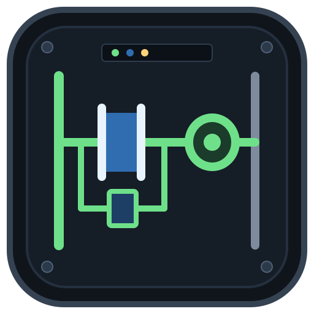

# Ladder Quest

  

PLC 래더 로직으로 가상 현장 설비를 움직이는 무료 브라우저 퍼즐 게임이다. 미션 사양을 읽고 래더 다이어그램을 직접 편성해 요구된 동작을 재현한다.

## 바로 시작하기

**[Ladder Quest 실행하기](https://plcmanjp.github.io/ladder-quest/)**

- 설치와 회원가입 없이 브라우저에서 바로 실행할 수 있다.
- PC, 태블릿과 스마트폰의 가로, 세로 화면을 지원한다.
- 한 번 접속해 필요한 파일을 받은 뒤에는 오프라인에서도 실행할 수 있다.
- 진행 기록은 사용 중인 브라우저에 저장된다.

## 어떤 게임인가

화면의 현장 설비와 미션 사양을 보고, 제한된 소자로 래더 회로를 만든다. 재생하면 전력 흐름과 설비 동작을 함께 관찰할 수 있다. 회로가 완성되면 시운전 검증을 실행해 모든 검사 항목을 통과시키면 된다.

클리어한 뒤에는 소자 수, 렁 수와 달성 스캔 수를 비교하며 더 짧고 빠른 회로에 도전할 수 있다.

## 게임 모드

### 기초

7개 챕터, 24개 라운드에서 래더의 기본부터 타이머, 카운터, 비교와 사칙연산까지 단계적으로 다룬다.

### 미로

10개 라운드와 샌드박스 2종에서 래더로 드론의 이동 규칙을 만든다. 센서 입력을 읽고 목적지까지 움직이는 알고리즘을 설계한다.

### 신호등

4개 라운드에서 차량과 보행자 신호를 제어한다. 충돌을 막으면서 정해진 교통 흐름을 만족시키는 회로를 만든다.

## 플레이 방법

1. 첫 화면에서 모드와 라운드를 고른다.
2. 현장 설비, 미션 설명과 I/O 할당표를 읽는다.
3. 정지 상태에서 접점, 코일과 명령을 래더 칸에 배치한다.
4. 재생, 일시정지와 1스캔 실행으로 회로 동작을 확인한다.
5. 시운전 검증을 실행해 모든 검사 항목을 통과시킨다.
6. 클리어 기록을 확인하고 더 효율적인 회로로 다시 도전한다.

래더 편집은 정지 상태에서만 가능하다. 실행 중에는 현장 입력을 조작하고 전력 흐름을 관찰할 수 있다.

## 처음 보는 기호

| 기호 | 뜻 |
|---|---|
| `X` | 센서와 스위치 같은 입력 |
| `Y` | 모터와 램프 같은 출력 |
| `M` | 회로 안에서 사용하는 내부 릴레이 |
| `T` | 시간을 재는 타이머 |
| `C` | 횟수를 세는 카운터 |
| `D` | 숫자를 저장하는 데이터 레지스터 |

기초 모드는 PLC를 처음 접하는 사용자를 위해 필요한 개념을 첫 챕터부터 순서대로 소개한다.

## 설치와 오프라인 실행

지원하는 브라우저에서는 주소창의 설치 메뉴나 홈 화면 추가 기능으로 앱처럼 설치할 수 있다. 설치하지 않아도 같은 게임을 이용할 수 있다.

진행 기록은 계정이나 서버가 아니라 현재 브라우저에 저장된다. 브라우저의 사이트 데이터나 저장 공간을 삭제하면 진행 기록도 함께 사라질 수 있다.

## 문제 제보

화면이 잘리거나 조작이 되지 않는 문제를 발견하면 [GitHub Issues](https://github.com/plcmanjp/ladder-quest/issues)에 사용한 기기, 브라우저와 문제가 발생한 라운드를 적어 제보할 수 있다.

게임에 관한 더 자세한 소개는 [Ladder Quest 소개 글](https://plcman.tistory.com/256)에서 볼 수 있다.

## 저장소 안내

이 저장소는 GitHub Pages 공개 배포 산출물만 보유한다. 개발 소스, 내부 명세와 작업 기록은 포함하지 않는다.
